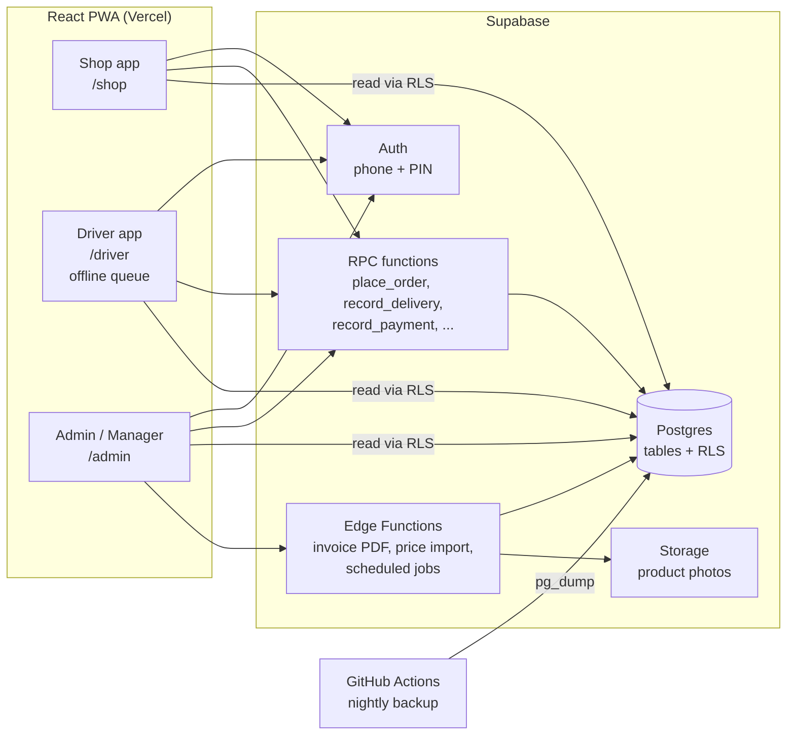
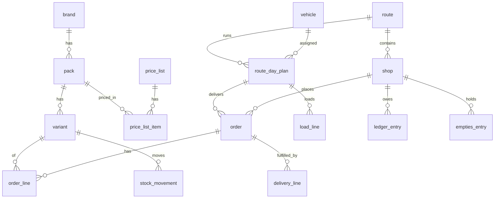

# MarginMart Distribution: High-Level Design

| | |
|---|---|
| Status | Draft v0.1 |
| Date | 2026-10-29 |
| Based on | [PRD.md](./PRD.md) |

## 1. Summary

A single React PWA (an installable web app) with three surfaces: **Shop**, **Driver** and **Admin**. It runs on **Supabase**:
- Postgres stores the data.
- Supabase Auth handles phone + PIN login.
- Storage holds product photos only.
- Edge Functions do server-side work.

Business rules that touch money or stock run inside **Postgres functions (RPCs)**. Each one runs as a single transaction, and the browser can't bypass it. Row-level security (RLS) on every table limits each role to its own data. The driver surface works offline using a local action queue that syncs with idempotent RPCs.



## 2. Key decisions

| # | Decision | Why | Alternative rejected |
|---|---|---|---|
| D1 | Keep React 19, Vite and TypeScript, and reuse the existing repo | The team already knows them, and the existing app is already built with them | Next.js: SSR isn't needed for an app behind login |
| D2 | One app with role-based routes (`/shop`, `/driver`, `/admin`), code-split per surface | One deploy, one auth, shared components. Shopkeepers only download shop code | Three separate apps: triple the setup for 13 users plus 150 shops |
| D3 | Supabase Postgres as the only source of truth | Relational data, RLS, transactions, free tier fits the scale | Google Sheets: no transactions or access control |
| D4 | Writes go through RPCs, and direct table writes are blocked for non-admins | Money and stock rules live in one place, run atomically and can't be changed from DevTools | Writing from the client: logic is spread out and unsafe |
| D5 | Ledger is append-only, and balances are derived | Audit trail, no drift, corrections are visible | Mutable balance column |
| D6 | Money stored as `bigint` paise | No floating-point rounding | `numeric` rupees: also fine, but paise keeps the JS side simple |
| D7 | PWA with an IndexedDB action queue (browser storage) for drivers | Weak network on routes. No app-store release needed | Native app: overkill for v1 |
| D8 | **Phone number + 6-digit PIN** login (Supabase email/password auth with a synthetic email `<phone>@login.marginmart.app`). The manager sets or resets the PIN and sends it to the shop on WhatsApp | Zero cost. SMS OTP always costs per message (Supabase uses a paid provider, and Firebase phone auth is billed per SMS) | SMS OTP: paid, and India needs DLT template registration |
| D9 | No Telegram bot, and no paid WhatsApp API in v1 | Use `wa.me` and Web Share links from the driver's phone | Running a bot: a second ordering channel to maintain |
| D11 | **Zero-cost constraint**: every service must be on a free tier | Owner's requirement | Any paid plan |
| D12 | Host on **Vercel Hobby** (owner's choice, already set up). Accepted risk: Hobby terms restrict use to non-commercial projects. Fallback is Cloudflare Pages, a static SPA that moves with no code changes | Existing deploy and familiarity | Cloudflare Pages (kept as fallback) |
| D13 | Invoices are a **printable HTML page** (print CSS), saved as PDF or shared via the phone's print/share sheet. Price-list Excel is parsed **in the browser with `exceljs`**. Nothing is stored; invoices are rebuilt from snapshotted data | HTML renders Devanagari (conjuncts, matras) correctly; jsPDF does not. `exceljs` is maintained on npm; the npm `xlsx` package is stale with known advisories | jsPDF; SheetJS from npm; server-side PDF in Storage |
| D14 | Supabase project region should be Mumbai (`ap-south-1`). Verify before the pilot; moving later means a new project | Latency for Indian users | — |
| D10 | Hindi and English through `i18next`, with bilingual product names stored in the database | Static UI strings in JSON, data strings in columns | Machine translation at runtime |

## 3. Frontend architecture

```
src/
  app/            router, auth gate, role redirect, providers
  features/
    shop/         catalogue, cart, orders, balance
    driver/       stops, delivery screen, collection, end-of-day, offline queue
    admin/        dashboard, catalogue, price lists, shops, routes, orders,
                  loading sheet, ledger, reconciliation, stock, expenses, users
  shared/
    api/          typed Supabase client, RPC wrappers, generated DB types
    ui/           design system (buttons, steppers, tables, sheets)
    i18n/         en.json, hi.json
    money.ts      paise <-> ₹ formatting
  sw/             service worker (vite-plugin-pwa)
```

- **Routing:** after login, the app reads `profiles.role` and redirects to the matching surface. Each surface is a lazy-loaded chunk.
- **Server state:** TanStack Query handles caching, retries and background refresh. There's no global store beyond the cart and the offline queue.
- **Types:** `supabase gen types` generates the database types, and all queries are typed against them.
- **Design:** mobile-first for Shop and Driver, with large tap targets and a quantity stepper. Admin is desktop-first with dense tables.
- **Old code:** tag the repo `v0-deal-sourcing`, then delete the existing `AdminDashboard.tsx`, its modals, `scripts/`, `telegram-mcp/` and the old tests.

## 4. Data model

All tables have `id uuid pk`, `created_at` and `created_by`. Money columns are `bigint` paise. Quantities are integer cases unless noted.



### 4.1 Tables

**Identity**
| Table | Key columns |
|---|---|
| `profiles` | `user_id` (pk, → auth.users), `role` enum(`admin`,`manager`,`driver`,`shop`), `name`, `phone`, `shop_id` (shop role), `vehicle_id` (driver default), `active` |
| `join_requests` | `phone`, `shop_name`, `address`, `status` enum(`pending`,`approved`,`rejected`), `reviewed_by` |

**Catalogue and pricing**
| Table | Key columns |
|---|---|
| `brand` | `name` |
| `pack` | `brand_id`, `name_en`, `name_hi`, `size_label`, `units_per_case`, `mrp_paise`, `hsn`, `gst_rate_bp`, `cess_rate_bp`, `is_returnable`, `sort`, `active` |
| `variant` | `pack_id`, `flavour_en`, `flavour_hi`, `image_path`, `active` |
| `price_list` | `name`, `effective_from`, `price_includes_gst` bool, `status` enum(`draft`,`active`,`archived`) |
| `price_list_item` | `price_list_id`, `pack_id`, `trade_price_paise`, `scheme_value_paise`, `scheme_type` enum(`net_rate`,`bogo_on_mrp`), `remarks`. **Net rate** is a generated column: trade price − scheme value |

At most one `active` price list, enforced with a partial unique index. Activating a list archives the previous one inside an RPC.

**Network**
| Table | Key columns |
|---|---|
| `route` | `name`, `visit_days` smallint[] (ISO weekdays, e.g. `{1,4}`), `active` |
| `vehicle` | `name`, `capacity_cases`, `active` |
| `shop` | `name`, `owner_name`, `phones` text[], `address`, `gstin`, `route_id`, `stop_seq`, `credit_limit_paise`, `credit_days` (default 7), `order_block_override_until`, `active` |
| `route_day_plan` | `route_id`, `date`, `vehicle_id`, `driver_id`, `status` enum(`planning`,`loaded`,`out`,`closed`). Unique (`route_id`, `date`) |

**Orders and fulfilment**
| Table | Key columns |
|---|---|
| `order` | `shop_id`, `route_day_plan_id`, `source` enum(`shop`,`manager`,`driver_van`), `status` enum(`placed`,`locked`,`delivered`,`partially_delivered`,`cancelled`), `price_list_id` |
| `order_line` | `order_id`, `variant_id`, `qty_ordered`, `unit_price_paise` (snapshot of net rate), `trade_price_paise`, `scheme_value_paise`, `mrp_paise`, `gst_rate_bp`, `cess_rate_bp` (all snapshots), `cancel_reason` |
| `load_line` | `route_day_plan_id`, `variant_id`, `qty_ordered_total`, `qty_spare`, `qty_returned` |
| `delivery_line` | `order_id`, `order_line_id` (null for van sale), `variant_id`, `qty_delivered`, `unit_price_paise`, `short_reason` enum, `client_action_id` (unique, for idempotency) |

**Money and stock**
| Table | Key columns |
|---|---|
| `invoice` | `shop_id`, `order_id`, `number` (e.g. `MM/26-27/000123`), `fy`, `taxable_paise`, `cgst_paise`, `sgst_paise`, `cess_paise`, `total_paise`, `pdf_path`, `status` (`issued`,`void`) |
| `invoice_counter` | `fy` pk, `last_no`. Incremented with row lock, so numbering never has gaps |
| `ledger_entry` | `shop_id`, `type` enum(`invoice`,`payment`,`adjustment`,`reversal`,`opening`), `amount_paise` (+ debit owed, − credit paid), `invoice_id`, `payment_mode` (`cash`,`upi`), `upi_ref`, `reverses_id`, `client_action_id` unique, `note`. **Insert only** |
| `cash_handover` | `route_day_plan_id`, `expected_cash_paise`, `expected_upi_paise`, `handed_cash_paise`, `received_by`, `note` |
| `stock_movement` | `variant_id`, `type` enum(`receipt`,`load`,`return`,`delivery`,`adjustment`,`damage`), `qty` (signed), `buy_price_paise` (receipts), `supplier_invoice_no`, `route_day_plan_id`. **Insert only** |
| `empties_entry` | `shop_id`, `pack_id`, `kind` (`crate`,`bottle`), `qty` (+ given, − returned), `deposit_paise`. **Insert only** |
| `expense` | `month`, `category` (salary, rent, electricity, fuel, vehicle, loading, other), `amount_paise`, `type` (`expense`,`income`), `note` |
| `settings` | singleton: `cutoff_time` (default 23:59 previous day), `default_credit_days`, `crate_deposit_paise`, `bottle_deposit_paise`, `business_gstin`, `invoice_prefix` |
| `audit_log` | `actor`, `table_name`, `row_id`, `action`, `before` jsonb, `after` jsonb, `at`. Written by triggers on prices, ledger, orders, shops and settings |

### 4.2 Derived views
- `v_shop_balance`: sum of `ledger_entry.amount_paise` per shop, plus the overdue amount, using invoices older than `credit_days` and payments applied oldest first.
- `v_stock_on_hand`: sum of `stock_movement.qty` per variant.
- `v_empties_balance`: per shop, per pack and kind.
- `v_route_load`: what the loading sheet would contain, before it's locked into `load_line`.
- `v_monthly_pnl`: delivered revenue minus COGS (cost of goods sold, valued at the weighted-average buy price from receipts), minus expenses, plus other income.

## 5. Security: roles and RLS

A helper function, `auth_role()`, reads the caller's role from `profiles`. Policies use it, with no custom JWT claims in v1.

| Data | shop | driver | manager | admin |
|---|---|---|---|---|
| Catalogue, active price list | read | read | read | read/write |
| Price lists (draft/archived), settings | – | – | read | read/write |
| Own `shop` row | read | read (shops on today's plan) | read/write | read/write |
| Orders and lines | own shop | today's plan for own vehicle | all | all |
| Ledger, invoices | own shop | shops on today's plan (balance only) | all, read | all, read |
| Stock, expenses, P&L | – | – | stock read; expenses read | all |
| Users and roles | – | – | – | read/write |
| Audit log | – | – | read | read |

- **Writes:** no role gets direct `insert`/`update`/`delete` on money, stock or order tables. Every write goes through `security definer` RPCs. These run with elevated rights and check the role and the business rules first. Admins edit catalogue and settings through direct table writes, gated by RLS and recorded by audit triggers.
- **Voiding:** only admins can void a ledger entry or invoice. A void writes a `reversal` entry and never deletes.
- **Service role key:** used only in Edge Functions. The frontend ships only the anon key.

## 6. Core flows

### 6.1 Cutoff and route-day assignment
For each route and date, `route_day_plan` rows for the next 14 days are created by a daily scheduled job (pg_cron). When a shop orders, `place_order` picks the **next plan for the shop's route whose cutoff hasn't passed**. Cutoff is midnight before the route day, in IST. The shop app shows that plan's date and cutoff.

### 6.2 Place order: `place_order(shop_id, lines[], client_action_id)`
1. Check the caller is allowed: the shop itself, or manager/admin with `source=manager`.
2. Check the shop is active. Check credit: if `balance + cart total > credit_limit` or overdue > 0, and there's no override, reject with `CREDIT_BLOCKED`.
3. Resolve the target plan (6.1). If the shop already has a `placed` order on that plan, merge lines into it, so each shop has one order per visit.
4. Snapshot prices from the active price list onto each line.
5. Return the order with totals.

`update_order` and `cancel_order` are allowed while `now() < cutoff` and the order status is `placed`. Manager and admin can act after cutoff, until the plan is `loaded`.

### 6.3 Loading sheet
- Before departure, the manager opens the plan and sees `v_route_load` (ordered cases per variant), adds spare cases and assigns the vehicle and driver.
- `lock_load(plan_id)` writes `load_line`s and a `stock_movement(load, −qty)`, sets orders to `locked`, and sets the plan to `loaded`.
- A capacity warning shows if the total is above `vehicle.capacity_cases`.

### 6.4 Delivery at a shop (driver, offline-capable)
The driver screen shows the order lines, plus "add from truck" limited to spare stock left on the truck. Submitting calls:

`record_delivery(order_id | shop_id, lines[{order_line_id?, variant_id, qty, short_reason?}], payment?{mode, amount, upi_ref}, empties?[], client_action_id)`

In one transaction:
1. Insert `delivery_line`s. Van-sale lines create a `driver_van` order if the shop has none on this plan.
2. Check the van-sale quantity ≤ spare remaining on the truck.
3. Create the invoice from delivered quantities only (R1: a simple bill with a sequential number; R2: full GST breakup and PDF).
4. Insert a `ledger_entry(invoice, +total)`, and a `ledger_entry(payment, −amount)` if paid.
5. Insert an `empties_entry` (R2) and a `stock_movement(delivery)`.
6. Set the order to `delivered` or `partially_delivered`.

Retries are safe: if a `client_action_id` has already been processed, the function returns the stored result.

### 6.5 Offline queue (driver)
- When the plan is `out`, the driver app caches that day's data in IndexedDB: plan, stops, orders, shop balances, truck stock and the catalogue.
- Each action (delivery, payment) gets a UUID `client_action_id` and goes into a queue in IndexedDB. The UI updates right away from local state.
- A sync worker sends queued actions in order whenever online (on the `online` event, on app focus, and every 30 seconds). A response of success or "already processed" removes the action from the queue. A business error (e.g. not enough spare stock) marks it failed for the driver to fix.
- The header shows "N pending sync". End of day is blocked until the queue is empty.
- Invoice numbers are assigned on the server. While offline, the shared bill shows "provisional", and the final number appears after sync. That's acceptable for v1 because the bill is mainly for the shop's reference.

### 6.6 End of day: `close_day(plan_id, returned[], cash_handed, note)`
- Returned stock = loaded − delivered. The driver enters the actual count, and any difference is logged as `stock_movement(adjustment)` with a flag.
- Expected cash and UPI come from the day's payment entries. The handover is recorded and discrepancies are flagged on the admin dashboard.
- The plan is set to `closed`. Only admins can reopen it.

### 6.7 Payments outside delivery
`record_payment(shop_id, mode, amount, upi_ref, client_action_id)` is used by manager or admin when a shop pays at the office or transfers money. Payments aren't tied to specific invoices. Overdue is calculated by applying payments to the oldest invoices first.

### 6.8 Price list import
- An admin uploads the PepsiCo sheet as Excel or CSV. The browser parses it (D13) and saves it as a **draft** `price_list` and matches rows to `pack`s by name.
- The admin sees the matched rows and the ones that didn't match, then fixes or maps them.
- `activate_price_list(id)` sets the effective date and archives the previous list.

### 6.9 Invoices (R2)
- The invoice number comes from `invoice_counter` for the current financial year (April to March), taken under a row lock.
- The GST breakup uses the snapshotted rates on each line. If `price_includes_gst`, taxable = total ÷ (1 + gst + cess). Otherwise tax is added on top.
- Same-state supply is assumed, so CGST and SGST each get half the GST.
- The browser renders a printable HTML invoice from the invoice's snapshotted data. Nothing is stored. The driver shares the PDF file through the phone's share sheet to WhatsApp, and the shop can re-download it from its invoices screen at any time.

## 7. Notifications (v1)
There are no paid channels:
- Driver: after delivery, share the bill using the Web Share API or a `wa.me/<phone>?text=` link with the invoice URL.
- Admin: in-app dashboard alerts for overdue shops, cash discrepancies and pending join requests.
- Shop: the app shows its status when opened.

## 8. Infrastructure and environments

| Item | Choice |
|---|---|
| Hosting | Vercel Hobby, using the existing `vercel.json` SPA rewrite and a `*.vercel.app` subdomain (a custom domain is optional and costs about ₹800/yr) |
| Database plan | Supabase **Free**: 500 MB DB, 1 GB storage, 50k MAU, 2 projects. Expected usage after a year is well under 50 MB. Projects pause after 7 idle days, which daily use and the nightly backup job prevent |
| Backups | The free plan has **no backups**. A GitHub Actions nightly job (free minutes) runs `pg_dump`, encrypts the dump with `age`, and stores it as a 30-day artifact in a private repo. The DB URL and key are GitHub secrets. Restores get tested monthly |
| Backend | Supabase project. The existing `marginmart` project gets wiped after tagging, or a fresh project is created (to decide) |
| Environments | `local` (Supabase CLI and Docker), `prod`. Add staging later if needed |
| Migrations | `supabase/migrations/*.sql` in the repo, applied through the CLI. No changes made from the dashboard |
| Seed | `supabase/seed.sql`: routes, vehicles, packs and variants from the PepsiCo sheet, a sample price list |
| Scheduled jobs | `pg_cron`: create route-day plans, mark overdue, nightly backup check |
| Login | Phone + PIN (D8). Supabase Auth rate limits plus a lockout after 5 failed attempts in `login_attempts`. Admins can also use free Google sign-in |
| Monitoring | Supabase logs. Sentry free tier (5k errors/month) for frontend errors |
| Recurring cost | **₹0/month** |

## 9. Testing strategy
- **Database:** pgTAP tests for each RPC and each RLS policy. For example, a shop can't read another shop's ledger, and a driver can't deliver on another vehicle's plan. This is where money bugs would come from, so it gets the most coverage.
- **Unit:** Vitest for pricing and GST maths, money formatting and the offline queue.
- **E2E:** Playwright against local Supabase, covering three flows:
  - order → lock load → deliver partial + van sale + pay → close day → balances correct
  - credit block
  - offline delivery that syncs later

## 10. Risks

| Risk | Impact | Mitigation |
|---|---|---|
| Shopkeepers don't adopt the app | Manager keeps taking phone orders | Manager or driver order-on-behalf is first-class. Track self-order % |
| Offline sync conflicts, such as two deliveries for one order | Duplicate billing | One delivery per order line, an idempotency key, and a server check that `qty_delivered` hasn't already been recorded |
| Incorrect GST setup | Non-compliant invoices | Rates are configurable per pack. CA sign-off before R2 goes live |
| Shared or guessed PINs | Someone orders on another shop's account | 6-digit PIN, lockout after 5 failures, manager reset, audit log shows the device and time of each order. Orders only bill on delivery, so a fake order is caught at the doorstep |
| Free-tier limits change or the project gets paused | Downtime or data loss | Nightly off-site backups. Usage is about 10% of limits. Moving to Supabase Pro ($25/mo) is the escape hatch, and no code changes are needed |
| PepsiCo sheet format changes | Import fails | The import shows unmatched rows. Manual price entry always works |
| Two admins editing at once | Overwrites | `updated_at` optimistic check on admin edits. Audit log |

## 11. Implementation order (R1)
1. Repo cleanup and tag. Supabase CLI set up locally. Base schema: identity, catalogue, network.
2. Auth with phone + PIN, profiles, role routing, RLS helpers, admin user management.
3. Admin: catalogue, price list (manual entry first, import later), routes, vehicles, shops with CSV import.
4. Shop app: catalogue grid, cart, `place_order`, cutoff, my orders, Hindi/English.
5. Admin orders, order-on-behalf, cancel. Route-day plans job.
6. Loading sheet and `lock_load`.
7. Driver app: stops, `record_delivery`, payments, bill share, then the offline queue.
8. Ledger views, credit block, `record_payment`, `close_day`, dashboard.
9. pgTAP and E2E suites. Pilot one route for one week.

## 12. Open technical questions
1. Reuse the existing Supabase project, or create a fresh one? Fresh is cleaner. Reusing keeps the URL and keys.
2. ~~Which SMS provider?~~ Resolved: phone + PIN login, no SMS (D8).
3. Should the shop app also allow a WhatsApp-share order fallback ("send this cart to the manager")? Cheap to add, but it creates a second path.
